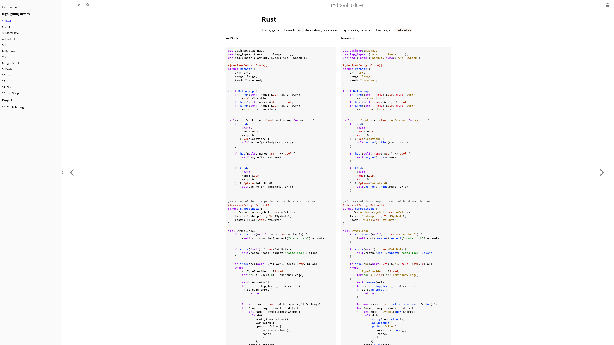

# mdbook-tsitter

> Tree-sitter syntax highlighting for [mdBook](https://rust-lang.github.io/mdBook/) — for any language you can point a grammar at.

<p align="center">
  <a href="https://spectralflux.dev/mdbook-tsitter">
    
  </a>
</p>

<p align="center">
  <a href="https://spectralflux.dev/mdbook-tsitter"><strong>Open the live example book</strong></a>
</p>

<!-- ANCHOR: introduction -->

`mdbook-tsitter` is an mdBook preprocessor that parses fenced code blocks with
[tree-sitter](https://tree-sitter.github.io/) and renders the resulting captures
as themeable HTML. It is grammar-agnostic: list a language it knows, or name any
grammar's git repository or a local checkout, and the same preprocessor can
handle anything from Rust and Lua to a language of your own.

## Features

- **Grammar-agnostic.** Over 300 common languages work by name; any other
  tree-sitter grammar works from its repository or a local checkout. Grammars
  are fetched and compiled on the first build.
- **Structural highlighting.** Definitions, calls, types, parameters,
  properties, macros, and other syntax can receive distinct styles whenever the
  grammar's queries distinguish them.
- **Embedded languages.** Injection queries can highlight fenced code inside
  Markdown, languages embedded in strings, and other nested syntax.
- **Themeable capture classes.** Captures become predictable `ts-…` CSS
  classes, with a bundled stylesheet that follows mdBook's light, rust, coal,
  navy, and ayu themes. A `highlight_ts.css` in the theme directory replaces
  it, and a theme that only restyles highlight.js colours tree-sitter blocks
  to match.
- **Side-by-side blocks.** Label consecutive blocks with `pane="…"` to show
  them side by side under their labels, such as before and after a change,
  or the same idea in several languages.
- **Hand-marked tokens.** In a block marked `lsp`, write `§token|text§` to
  style `text` as an LSP semantic token, for what only a language server knows.
- **Language aliases and locals queries.** Match several fence names to one
  grammar and opt into scope-aware query behavior where the grammar supports it.
- **Selective processing.** Leave individual blocks to mdBook when you need its
  built-in Rust Playground behavior or other native code-block features.
- **Build-time rendering.** Highlighted HTML is generated with the book; the
  reader does not need a tree-sitter runtime.
- **Plays well with other preprocessors.** Blocks are found exactly as mdBook
  finds them, and highlighted code stays out of reach of math preprocessors.

The [documentation book](https://spectralflux.dev/mdbook-tsitter) is built with
the preprocessor itself. Its examples include Macaulay2, a grammar outside
nvim-treesitter's list, and substantial side-by-side comparisons in Rust, Python, TypeScript, JavaScript,
Go, Java, C, C++, Bash, PHP, Lua, and Haskell, and its
[`book.toml`](examples/languages/book.toml) is a complete configuration
example.

## Installation

Install the preprocessor from crates.io:

```sh
cargo install mdbook-tsitter
```

The `mdbook-tsitter` binary must be available on `PATH` when `mdbook build`
runs. Grammars are fetched and compiled, so the build machine also needs `git`
and a C compiler (`cc`, `gcc`, `clang`, or MSVC) on the build machine; see
[Grammar sources](https://spectralflux.dev/mdbook-tsitter/guide/grammar-sources.html).

## Quick start

List the languages to highlight in `book.toml`:

```toml
[preprocessor.tsitter]

[preprocessor.tsitter.languages]
rust = {}
python = {}
typescript = { aliases = ["ts"] }
```

The first build fetches and compiles each grammar; later builds reuse it. After
that, ordinary fenced blocks for the configured languages are highlighted
automatically:

````markdown
```rust
fn main() {
    println!("highlighted at build time");
}
```
````

Build the book as usual:

```sh
mdbook build
```

Languages that are not configured, blocks without a language tag, and blocks
that opt out are left untouched for mdBook to handle.

<!-- ANCHOR_END: introduction -->

## Configuring languages

<!-- ANCHOR: configuration -->

Everything lives under `[preprocessor.tsitter]`.

### Preprocessor options

| key      | default | meaning |
| -------- | ------- | ------- |
| `inject` | `true`  | Highlight embedded languages using configured injection queries. Only configured languages are used. Set this to `false` to disable injections globally. |
| `everforest` | `false` | Include the Everforest dark theme, its theme-picker entry, and complete tree-sitter and highlight.js styles on every chapter. |
| `default-css` | `true` | Embed the highlighting stylesheet (the theme directory's `highlight_ts.css`, or the bundled one) in chapters with highlighted blocks. See [Theming](https://spectralflux.dev/mdbook-tsitter/guide/theming.html). |

### Language options

Add one entry to `[preprocessor.tsitter.languages]` per grammar. A language
from the [built-in list](https://spectralflux.dev/mdbook-tsitter/guide/grammar-sources.html#from-the-built-in-list)
needs no keys at all; any other grammar needs `git` as its source. Paths are
relative to the book root.

| key          | required | meaning |
| ------------ | -------- | ------- |
| `git`        | for unlisted languages | URL of the grammar's git repository, or a path to a local one, fetched and compiled on demand. Defaults to the built-in list's repository. |
| `rev`        | no       | Tag, branch, or commit to use. Defaults to the built-in list's pinned revision, or for other repositories their default branch. |
| `location`   | no       | Subdirectory holding the grammar, for repositories with several grammars. Usually found automatically. |
| `highlights` | no       | Path to a highlights query, used instead of the grammar's. |
| `injections` | no       | Path to an injections query for embedded languages, used instead of the grammar's. |
| `locals`     | no       | Path to a locals query for scope-aware highlighting, used instead of the grammar's. |
| `aliases`    | no       | Code-fence names handled by this grammar; defaults to the entry's name. |
| `lsp`        | no       | `false` by default. Set `true` to read `§` as a token marker in every block of the language, not only those marked `lsp`; see [Hand-marked tokens](#hand-marked-tokens). |

A language may need its own table when it carries several keys:

```toml
[preprocessor.tsitter.languages.markdown]
aliases = ["md", "markdown"]
injections = "queries/markdown/injections.scm"
```

Injection queries can select another configured grammar using standard
`@injection.language` and `@injection.content` captures. All grammars share the
same capture-class table during a build, so embedded and host languages use the
same theme consistently.

### Rust Playground and hidden lines

Highlighted blocks keep mdBook's code-block features. Rust blocks stay
runnable in the Rust Playground, with the book's `[rust] edition`, the implicit
`fn main` wrapper, and annotations such as `ignore`, `noplayground`,
`mdbook-runnable`, or `edition2021` handled as mdBook handles them. Hidden
lines (`# ` in Rust, or a prefix from `hidelines=` or
`[output.html.code.hidelines]`) are collapsed behind mdBook's toggle:

````markdown
```rust
# use std::collections::HashMap;
let mut scores = HashMap::new();
scores.insert("tree-sitter", 1);
```
````

Editable playgrounds (`editable` with `[output.html.playground] editable =
true`) are replaced by mdBook's in-page editor, so they are always left to
mdBook.

### Leaving a block to mdBook

Processing a block replaces its Markdown with highlighted HTML. Add the
`notreesitter` annotation when a block should keep mdBook's highlight.js
highlighting instead:

````markdown
```rust,notreesitter
let highlighted = "by mdBook";
```
````

### Side-by-side blocks

Blocks labelled with `pane="…"` are shown side by side, and `compare` shows one
block as tree-sitter and highlight.js highlight it. See
[Side-by-side blocks](https://spectralflux.dev/mdbook-tsitter/guide/side-by-side.html).

### Hand-marked tokens

`§token|text§` in a block marked `lsp` styles `text` as an LSP semantic token. See
[Hand-marked tokens](https://spectralflux.dev/mdbook-tsitter/guide/marks.html).

### Alongside other preprocessors

mdBook runs preprocessors in the order set by their `before` and `after` keys,
and otherwise alphabetically by name. A highlighted block becomes HTML, so a
preprocessor that generates code blocks, or that must see a block as a code
fence, has to run before this one:

```toml
[preprocessor.tsitter]
after = ["links", "my-code-generator"]
```

Blocks are found with mdBook's own Markdown settings, so a block is highlighted
exactly when mdBook would render it as a code block. In highlighted code, `$`
and `\` are written as HTML entities, so math preprocessors such as
mdbook-katex leave the code alone whichever of the two runs first.

<!-- ANCHOR_END: configuration -->

## Side-by-side blocks

<!-- ANCHOR: side-by-side -->

Code blocks can be shown next to each other, each under a title: a change
before and after, the same idea in several languages, or one block as
tree-sitter and highlight.js highlight it.

### Panes

Give each block a `pane` annotation holding its title. Blocks with a `pane`
annotation that follow each other, separated only by blank lines, form one
group:

````markdown
```rust,pane="Before"
let total = a + b;
```

```rust,pane="After"
let total = a.saturating_add(b);
```
````

The group is shown as equal columns, each under its title, centred above the
block. On screens narrower than 760 pixels the panes stack instead.

- **Titles.** Quote a title that contains spaces or commas, as in
  `pane="Before, as written"`; a single word needs no quotes, as in
  `pane=Before`. A title is plain text, shown exactly as written.
- **Any number of panes.** A group can hold two blocks or more, each in its
  own language.
- **Each pane renders as its block would on its own.** A block in a configured
  language is highlighted with tree-sitter. A block marked `notreesitter`, in
  a language that is not configured, or in an editable playground is left to
  mdBook. Other annotations keep their meaning, so Rust panes keep their Run
  button and hidden lines.
- **Ending a group.** Anything other than a blank line between two blocks,
  such as a paragraph, a heading, or an HTML comment (`<!-- -->`), ends the
  group, so two groups can follow each other.
- **Top-level blocks only.** Like highlighting, panes apply to fences at the
  start of a line. A block inside a list item or a blockquote is left to mdBook
  as written.

### Comparing with highlight.js

The `compare` annotation shows one block twice: on the left highlighted with
tree-sitter, on the right as mdBook highlights it with highlight.js.

````markdown
```rust,compare
fn main() {
    println!("side by side");
}
```
````

It is a shorthand for two panes from the same code:

````markdown
```rust,pane="tree-sitter"
fn main() {
    println!("side by side");
}
```

```rust,notreesitter,pane="highlight.js"
fn main() {
    println!("side by side");
}
```
````

### Styling

A group becomes the following HTML, with the layout in the embedded
stylesheet:

```html
<div class="treesitter-side-by-side">
  <div class="treesitter-pane">
    <div class="treesitter-pane-label">Before</div>
    <pre>…</pre>
  </div>
  …
</div>
```

Rules in `additional-css` override the layout, for example to widen the gap
between panes or align titles to the left:

```css
.treesitter-side-by-side { column-gap: 2.5rem; }
.treesitter-pane-label { text-align: left; }
```

A `highlight_ts.css` in the theme directory replaces the embedded stylesheet,
layout included, so a replacement that is started from
`mdbook-tsitter css` keeps it.

<!-- ANCHOR_END: side-by-side -->

## Hand-marked tokens

<!-- ANCHOR: marks -->

A grammar sees syntax only. A language server also knows that one name is a
method and another a local, and a book about it needs to show that. Add the
`lsp` annotation to a block, and wrap text in `§token|text§`, where `token` is
an LSP semantic token type, optionally followed by modifiers, separated by
dots.

````markdown
```rust,lsp
enum §enum|E§ { A, B }
§function.defaultLibrary|scan§(list, print);
```
````

In such a block `§` is the marker: text alternates between code and tokens,
and nothing else is read, so it works the same in any language, `$` and `${…}`
included, in strings and comments too. In the rare code that contains a `§`,
write `§§` for one:

````markdown
```bash,lsp
echo $HOME is §variable|home§ and costs §§5
```
````

An unbalanced `§` or a token without a valid `type|` is reported and the block
is skipped. To read `§` this way in every block of a language, set
`lsp = true` for it under `[preprocessor.tsitter.languages]`.

To recolour a token, set the CSS variable named after it, anywhere in your
`additional-css`:

```css
:root {
  --lsp-enum: #d699b6;
  --lsp-method: #e69875;
  --lsp-mod-deprecated: #859289;
}
```

`--lsp-<type>` colours a token type, written in lowercase (`--lsp-enummember`),
and `--lsp-mod-<modifier>` a modifier (`--lsp-mod-defaultlibrary`). No selectors
or specificity to think about, and it works the same in every theme, Everforest
included. Variables left unset keep the bundled colours.

The bundled stylesheets know every token type and modifier of m2-ls and
rust-analyzer, and the standard ones of the protocol, in every mdBook theme and
in Everforest. A token type has the colour of the tree-sitter capture closest to
it (an `enum` is coloured like a `type`). A modifier leaves the colour of its
type alone until you set `--lsp-mod-<modifier>`; `strong`, `emphasis`, `link`,
`deprecated` and `intraDocLink` also set bold, italic, underline and
strike-through.

Modifiers are what make marks expressive, because they combine with any type.
Compound selectors style exactly a type with a modifier:

```css
:root { --lsp-mod-controlflow: var(--ts-orange); }   /* `match`, `if`, `.await` */
.lsp-variable.lsp-mod-mutable { text-decoration: underline; }
.lsp-function.lsp-mod-async { font-style: italic; }
code[data-language="rust"] .lsp-mod-unsafe { color: var(--ts-red); }
```

Token and modifier names are not limited to the LSP standard; a server's own
types work too. The bundled stylesheets colour the standard ones, and anything
else stays plain until you give it a rule. Map it to one of the colour roles
(`--ts-type`, `--ts-function`, `--ts-keyword`, `--ts-string`, `--ts-number`,
`--ts-special`, …) or a hue (`--ts-orange`, `--ts-blue`, …), which every mdBook
theme and Everforest redefine, and one line covers all of them:

```css
.lsp-mything { color: var(--ts-special); }
```

For more than colour, the span is `<span class="lsp-function lsp-mod-defaultlibrary">`
inside a `<code data-language="…">`, so ordinary selectors work too:
`code[data-language="m2"] .lsp-method { font-style: italic; }`.

- The markers are removed before the code is parsed, so the grammar, the Copy
  button and the Run button see plain code.
- A token can span several grammar tokens, such as `std::mem::drop`, and styles
  each of them. Tokens do not nest.

## Marks and Neovim

<!-- ANCHOR: marks-nvim -->

`tools/lsp-marks` is a Neovim plugin (add it to the runtime path) that converts in
both directions:

- `:[range]LspMarksYank` copies the semantic tokens of the language server
  attached to the buffer as marks. It uses the server of your running editor,
  with your own settings, and leaves out what a grammar already colours.
- `:LspMarksPreview [filetype]` shows a buffer written in marks as highlighted
  code in a split that follows every edit. Markers are stripped first, so
  tree-sitter parses clean code, and tokens are coloured with `@lsp.type.*`,
  `@lsp.mod.*` and `@lsp.typemod.*`, as Neovim colours real semantic tokens.

To generate marks without an editor, run
`nvim --headless -l tools/lsp-marks/headless.lua <file> [first:last]`; it starts the
server itself. It is a bare LSP client, so it works with any server that
speaks semantic tokens.

<!-- ANCHOR_END: marks-nvim -->

<!-- ANCHOR_END: marks -->

## Grammar sources

<!-- ANCHOR: grammar-sources -->

### From the built-in list

The preprocessor knows the repositories of the
[grammars nvim-treesitter supports](https://github.com/nvim-treesitter/nvim-treesitter/blob/main/SUPPORTED_LANGUAGES.md),
each pinned to the revision nvim-treesitter tests, and of a few grammars
nvim-treesitter does not list, such as `macaulay2`, each pinned to a release.
Use the language's name there as its entry; `-` and `_` are interchangeable
(`c-sharp` or `c_sharp`).
A mistyped name fails with a suggestion when a listed name is close.

Their queries are nvim-treesitter's for the pinned revision, with the queries
they inherit from other languages; they are tested against exactly that parser
and are usually richer than a repository's own. Where nvim-treesitter has none,
or they do not match the parser, the repository's own queries are used.

### From a git repository

With `git`, the repository is shallow-fetched at `rev` and its parser
(`src/parser.c` plus any external scanner) is compiled with the platform's C
compiler. A grammar that commits no generated parser is generated first, which
needs the [tree-sitter CLI](https://github.com/tree-sitter/tree-sitter) and
Node.js.

The repository's `tree-sitter.json` locates the grammar and lists its queries,
so `location` is rarely needed. Queries a grammar builds on from another
grammar (TypeScript's extend JavaScript's) are fetched from that grammar's
repository, at the version the grammar's `package.json` pins. Without a
`tree-sitter.json`, queries are read from `queries/` beside the grammar or at
the repository root.

Checkouts and compiled parsers are cached per user, under `mdbook-tsitter/` in
the user cache directory (`$XDG_CACHE_HOME` or `~/.cache` on Linux and macOS,
`%LOCALAPPDATA%` on Windows), and shared between books. Network access is only
needed the first time a revision is used.

A cached checkout is reused for as long as it exists, so an unpinned grammar
stays at the commit first fetched. Pin `rev` to choose the version explicitly;
changing it fetches the new revision. Deleting the cache directory refetches
everything.

`git` may also be a path to a local repository, absolute or relative to the
book root, such as a grammar you are developing. Its `rev` (by default `HEAD`)
is resolved on every build, so new commits are picked up; uncommitted changes
are not.

```toml
[preprocessor.tsitter.languages.mylang]
git = "../tree-sitter-mylang"
```

To use different queries, such as your own, set `highlights` (and optionally
`injections` and `locals`) to query files in your book.

<!-- ANCHOR_END: grammar-sources -->

## Theming

<!-- ANCHOR: theming -->

A bundled stylesheet is embedded automatically. It covers standard
tree-sitter and nvim-treesitter capture names and follows mdBook's built-in
colour schemes, so most books need no CSS of their own.

The embedded stylesheet sits in the `mdbook-tsitter` cascade layer, so any rule
in your own `[output.html] additional-css` overrides it, whatever its
specificity. Add a stylesheet only for what you want to change, such as custom
capture names or colours for a custom mdBook theme:

```toml
[output.html]
additional-css = ["theme/highlighting.css"]
```

Each capture gets the `ts-` prefix, dots become hyphens, and every prefix is
emitted so broad rules can cascade into more specific ones:

| capture            | generated classes                    |
| ------------------ | ------------------------------------ |
| `keyword`          | `ts-keyword`                         |
| `keyword.operator` | `ts-keyword ts-keyword-operator`     |
| `string.regexp`    | `ts-string ts-string-regexp`         |

For example:

```css
.ts-comment {
  font-style: italic;
}

code[data-language="rust"] .ts-function-macro {
  color: var(--ts-purple);
}
```

Each highlighted block carries its fence tag as `data-language`, so a
`code[data-language="…"]` selector scopes a rule to one language.

### Everforest

Include the bundled Everforest dark theme (medium contrast):

```toml
[preprocessor.tsitter]
everforest = true
```

Select **Everforest** from the book's theme picker. This includes the book
interface, highlight.js colours for blocks left to mdBook, and tree-sitter
capture styles with language-specific overrides, italic comments, bold
headings, and underlined URLs. No extra CSS, script, or template is needed.
The theme is included on every chapter, even pages without code blocks.
It can also supply the highlights for books that already use an `.everforest`
theme. Custom `highlight_ts.css` and `default-css` still control the base
highlighting stylesheet; the Everforest option supplies its own styles.

### Theme directory

Like mdBook's own [theme files](https://rust-lang.github.io/mdBook/format/theme/index.html),
the highlighting stylesheet can be replaced from the book's theme directory
(`theme/`, or `[output.html] theme`). A `highlight_ts.css` there is embedded
instead of the bundled stylesheet, as mdBook uses a `highlight.css` there
instead of its highlight.js theme. Start from the bundled one:

```sh
mdbook-tsitter css > theme/highlight_ts.css
```

Without a `highlight_ts.css`, a theme that only replaces mdBook's highlight.js
stylesheets still colours tree-sitter blocks: the bundled stylesheet takes each
role's colour from the matching highlight.js class (`.hljs-keyword` for
keywords, `.hljs-string` for strings, and so on). A replaced `highlight.css`
applies to the light, rust, and custom themes, `tomorrow-night.css` to coal and
navy, and `ayu-highlight.css` to ayu, as in mdBook.

Set `default-css = false` under `[preprocessor.tsitter]` to embed no
highlighting stylesheet at all.

There is no fixed capture list in the preprocessor. Capture names come directly
from each grammar's queries; names beginning with `_` are treated as internal
and left unstyled.

<!-- ANCHOR_END: theming -->

## Upgrading

<!-- ANCHOR: upgrading -->

### From 3.x and 2.x

4.0 removes what 2.x and 3.x had deprecated and reports what it no longer
understands.

- **`library` and `symbol` are removed.** A language that still sets either
  fails the build with ``unknown field `library` ``, and so does any other
  setting a language table does not know. For a language from the
  [built-in list](https://spectralflux.dev/mdbook-tsitter/guide/grammar-sources.html#from-the-built-in-list),
  remove them along with the `highlights` path: the grammar and its queries are
  fetched instead. Any other grammar is named by `git`, its repository URL or a
  path to a local checkout.
- **A copy of the bundled stylesheet in `additional-css`** is no longer reported.
  The stylesheet is embedded, so remove the copy, or keep only your own changes
  in it. A copy that replaces the bundled theme belongs in
  `theme/highlight_ts.css`.
- **The library API changes.** `LanguageConfig` loses `library` and `symbol`,
  gains `lsp`, and rejects unknown keys. Code that builds one with a struct
  literal must be updated, and the `libloading` and `tree-sitter-language`
  dependencies are gone.

A 3.x or 2.x configuration such as

```toml
[preprocessor.tsitter.languages.rust]
library = "parsers/rust.so"
highlights = "queries/rust/highlights.scm"

[preprocessor.tsitter.languages.mylang]
library = "parsers/mylang.so"
highlights = "queries/mylang/highlights.scm"

[output.html]
additional-css = ["theme/treesitter.css"]
```

becomes

```toml
[preprocessor.tsitter.languages]
rust = {}

[preprocessor.tsitter.languages.mylang]
git = "https://github.com/someone/tree-sitter-mylang"
rev = "v1.0.0"
```

and the committed parsers, queries, and stylesheet can be deleted.

<!-- ANCHOR_END: upgrading -->

## How it works

<!-- ANCHOR: how-it-works -->

mdBook passes every chapter to the preprocessor as Markdown. `mdbook-tsitter`
parses it with mdBook's own Markdown parser and settings
([pulldown-cmark](https://docs.rs/pulldown-cmark) with the extensions
`[output.html]` enables), locates top-level fenced code blocks for configured
languages, and sends their source through tree-sitter-highlight.

The highlighted events become semantic CSS classes and are spliced back into
the chapter as ready-made HTML:

```html
<pre class="treesitter"><code class="no-highlight" data-language="rust">…spans…</code></pre>
```

The block deliberately has no `language-*` class: mdBook's highlight.js would
re-highlight any block whose `language-*` class names a language it knows,
even one marked `no-highlight`, and its colours would override the tree-sitter
ones. The fence tag is kept in `data-language` instead.

mdBook adds its own code-block features (Rust Playground markup, the implicit
`fn main`, hidden lines) only to plain-text blocks, so the preprocessor applies
the same rules before highlighting. A runnable Rust block, for example, becomes:

```html
<pre class="treesitter playground"><code class="no-highlight edition2021" data-language="rust">…spans…</code></pre>
```

Other preprocessors that run afterwards see highlighted blocks as HTML rather
than code fences, so `$` and `\` in highlighted code are written as HTML
entities, which math preprocessors do not read as their syntax.

A group of `pane="…"` blocks becomes a `treesitter-side-by-side` element with
one `treesitter-pane` per block. A pane holding a block left to mdBook keeps
its fence, separated from the surrounding HTML by blank lines so mdBook still
renders it as Markdown:

```html
<div class="treesitter-side-by-side">
<div class="treesitter-pane">
<div class="treesitter-pane-label">Before</div>

<pre class="treesitter">…</pre>

</div>
…
</div>
```

Finally, every chapter with a highlighted block gets the highlighting
stylesheet as a `<style>` element in the `mdbook-tsitter` cascade layer: the
theme directory's `highlight_ts.css`, or else the bundled stylesheet, with any
colours carried over from highlight.js stylesheets the theme replaces.
When `everforest = true`, every chapter also receives the bundled Everforest
stylesheet and theme-picker script.

<!-- ANCHOR_END: how-it-works -->

## Development

<!-- ANCHOR: development -->

Run the Rust test suite:

```sh
cargo test
```

With `mdbook` on `PATH` (or in `$MDBOOK`), the suite also builds test books
with the real mdBook and checks that every highlighted block has the same
structure as mdBook's own rendering of it: classes, hidden lines, and the text
the Run and Copy buttons use.

Build the documentation book, which runs the preprocessor from this checkout
through `cargo run` and fetches its grammars on the first build:

```sh
mdbook build examples/languages
```

Refresh the built-in grammar list from nvim-treesitter's current parser list
(needs `git`):

```sh
cargo xtask update-grammar-list
```

<!-- ANCHOR_END: development -->

## License

Licensed under either of [MIT](LICENSE-MIT) or [Apache-2.0](LICENSE-APACHE) at
your option.
