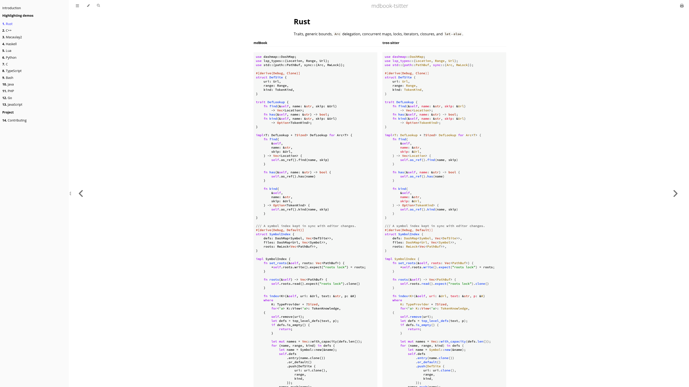

# mdbook-tsitter

> Tree-sitter syntax highlighting for [mdBook](https://rust-lang.github.io/mdBook/) — for any language you can point a grammar at.

<p align="center">
  <a href="https://spectralflux.dev/mdbook-tsitter">
    
  </a>
</p>

<p align="center">
  <a href="https://spectralflux.dev/mdbook-tsitter"><strong>Open the live example book</strong></a>
</p>

<!-- ANCHOR: introduction -->

`mdbook-tsitter` is an mdBook preprocessor that parses fenced code blocks with
[tree-sitter](https://tree-sitter.github.io/) and renders the resulting captures
as themeable HTML. It is grammar-agnostic: list a language it knows, name any
grammar's git repository, or supply a compiled parser and its highlight
queries, and the same preprocessor can handle anything from Rust and Lua to a
language of your own.

## Features

- **Grammar-agnostic.** Over 300 common languages work by name; any other
  tree-sitter grammar works from its repository or a prebuilt parser. Grammars
  are fetched and compiled on the first build.
- **Structural highlighting.** Definitions, calls, types, parameters,
  properties, macros, and other syntax can receive distinct styles whenever the
  grammar's queries distinguish them.
- **Embedded languages.** Injection queries can highlight fenced code inside
  Markdown, languages embedded in strings, and other nested syntax.
- **Themeable capture classes.** Captures become predictable `ts-…` CSS
  classes, with a bundled stylesheet that follows mdBook's light, rust, coal,
  navy, and ayu themes.
- **Language aliases and locals queries.** Match several fence names to one
  grammar and opt into scope-aware query behavior where the grammar supports it.
- **Selective processing.** Leave individual blocks to mdBook when you need its
  built-in Rust Playground behavior or other native code-block features.
- **Build-time rendering.** Highlighted HTML is generated with the book; the
  reader does not need a tree-sitter runtime.

The [documentation book](https://spectralflux.dev/mdbook-tsitter) is built with
the preprocessor itself. Its examples include a custom Macaulay2 grammar and
substantial side-by-side comparisons in Rust, Python, TypeScript, JavaScript,
Go, Java, C, C++, Bash, PHP, Lua, and Haskell, and its
[`book.toml`](examples/languages/book.toml) is a complete configuration
example.

## Installation

Install the preprocessor from crates.io:

```sh
cargo install mdbook-tsitter
```

The `mdbook-tsitter` binary must be available on `PATH` when `mdbook build`
runs. Grammars that are fetched rather than prebuilt also need `git` and a C
compiler (`cc`, `gcc`, `clang`, or MSVC) on the build machine; see
[Grammar sources](https://spectralflux.dev/mdbook-tsitter/guide/grammar-sources.html).

## Quick start

List the languages to highlight in `book.toml`:

```toml
[preprocessor.tsitter]

[preprocessor.tsitter.languages]
rust = {}
python = {}
typescript = { aliases = ["ts"] }
```

The first build fetches and compiles each grammar; later builds reuse it. After
that, ordinary fenced blocks for the configured languages are highlighted
automatically:

````markdown
```rust
fn main() {
    println!("highlighted at build time");
}
```
````

Build the book as usual:

```sh
mdbook build
```

Languages that are not configured, blocks without a language tag, and blocks
that opt out are left untouched for mdBook to handle.

<!-- ANCHOR_END: introduction -->

## Configuring languages

<!-- ANCHOR: configuration -->

Everything lives under `[preprocessor.tsitter]`.

### Preprocessor options

| key      | default | meaning |
| -------- | ------- | ------- |
| `inject` | `true`  | Highlight embedded languages using configured injection queries. Only configured languages are used. Set this to `false` to disable injections globally. |
| `default-css` | `true` | Embed the bundled stylesheet in chapters with highlighted blocks. See [Theming](https://spectralflux.dev/mdbook-tsitter/guide/theming.html). |

### Language options

Add one entry to `[preprocessor.tsitter.languages]` per grammar. A language
from the [built-in list](https://spectralflux.dev/mdbook-tsitter/guide/grammar-sources.html#from-the-built-in-list)
needs no keys at all; any other grammar needs `git` as its source. Paths are
relative to the book root.

| key          | required | meaning |
| ------------ | -------- | ------- |
| `git`        | for unlisted languages | URL of the grammar's git repository, or a path to a local one, fetched and compiled on demand. Defaults to the built-in list's repository. |
| `rev`        | no       | Tag, branch, or commit to use. Defaults to the built-in list's pinned revision, or for other repositories their default branch. |
| `location`   | no       | Subdirectory holding the grammar, for repositories with several grammars. Usually found automatically. |
| `highlights` | no       | Path to a highlights query, used instead of the grammar's. |
| `injections` | no       | Path to an injections query for embedded languages, used instead of the grammar's. |
| `locals`     | no       | Path to a locals query for scope-aware highlighting, used instead of the grammar's. |
| `aliases`    | no       | Code-fence names handled by this grammar; defaults to the entry's name. |
| `library`    | no       | **Deprecated.** Path to a compiled parser shared library, used instead of fetching; requires `highlights`. |
| `symbol`     | no       | **Deprecated.** Constructor symbol in `library`; defaults to `tree_sitter_<name>` with `-` changed to `_`. |

A language may need its own table when it carries several keys:

```toml
[preprocessor.tsitter.languages.markdown]
aliases = ["md", "markdown"]
injections = "queries/markdown/injections.scm"
```

Injection queries can select another configured grammar using standard
`@injection.language` and `@injection.content` captures. All grammars share the
same capture-class table during a build, so embedded and host languages use the
same theme consistently.

### Rust Playground and hidden lines

Highlighted blocks keep mdBook's code-block features. Rust blocks stay
runnable in the Rust Playground, with the book's `[rust] edition`, the implicit
`fn main` wrapper, and annotations such as `ignore`, `noplayground`,
`mdbook-runnable`, or `edition2021` handled as mdBook handles them. Hidden
lines (`# ` in Rust, or a prefix from `hidelines=` or
`[output.html.code.hidelines]`) are collapsed behind mdBook's toggle:

````markdown
```rust
# use std::collections::HashMap;
let mut scores = HashMap::new();
scores.insert("tree-sitter", 1);
```
````

Editable playgrounds (`editable` with `[output.html.playground] editable =
true`) are replaced by mdBook's in-page editor, so they are always left to
mdBook.

### Leaving a block to mdBook

Processing a block replaces its Markdown with highlighted HTML. Add the
`notreesitter` annotation when a block should keep mdBook's highlight.js
highlighting instead:

````markdown
```rust,notreesitter
let highlighted = "by mdBook";
```
````

<!-- ANCHOR_END: configuration -->

## Grammar sources

<!-- ANCHOR: grammar-sources -->

### From the built-in list

The preprocessor knows the repositories of the
[grammars nvim-treesitter supports](https://github.com/nvim-treesitter/nvim-treesitter/blob/main/SUPPORTED_LANGUAGES.md),
each pinned to the revision nvim-treesitter tests. Use the language's name
there as its entry; `-` and `_` are interchangeable (`c-sharp` or `c_sharp`).
A mistyped name fails with a suggestion when a listed name is close.

Their queries are nvim-treesitter's for the pinned revision, with the queries
they inherit from other languages; they are tested against exactly that parser
and are usually richer than a repository's own. Where nvim-treesitter has none,
or they do not match the parser, the repository's own queries are used.

### From a git repository

With `git`, the repository is shallow-fetched at `rev` and its parser
(`src/parser.c` plus any external scanner) is compiled with the platform's C
compiler. A grammar that commits no generated parser is generated first, which
needs the [tree-sitter CLI](https://github.com/tree-sitter/tree-sitter) and
Node.js.

The repository's `tree-sitter.json` locates the grammar and lists its queries,
so `location` is rarely needed. Queries a grammar builds on from another
grammar (TypeScript's extend JavaScript's) are fetched from that grammar's
repository, at the version the grammar's `package.json` pins. Without a
`tree-sitter.json`, queries are read from `queries/` beside the grammar or at
the repository root.

Checkouts and compiled parsers are cached per user, under `mdbook-tsitter/` in
the user cache directory (`$XDG_CACHE_HOME` or `~/.cache` on Linux and macOS,
`%LOCALAPPDATA%` on Windows), and shared between books. Network access is only
needed the first time a revision is used.

A cached checkout is reused for as long as it exists, so an unpinned grammar
stays at the commit first fetched. Pin `rev` to choose the version explicitly;
changing it fetches the new revision. Deleting the cache directory refetches
everything.

`git` may also be a path to a local repository, absolute or relative to the
book root, such as a grammar you are developing. Its `rev` (by default `HEAD`)
is resolved on every build, so new commits are picked up; uncommitted changes
are not.

```toml
[preprocessor.tsitter.languages.mylang]
git = "../tree-sitter-mylang"
```

To use different queries, such as your own, set `highlights` (and optionally
`injections` and `locals`) to query files in your book.

### From a compiled parser (deprecated)

A language may still name a prebuilt parser shared library with `library` (and
its constructor with `symbol`), with `highlights` pointing at its query. This is
deprecated and prints a warning; see
[Upgrading from 2.x](https://spectralflux.dev/mdbook-tsitter/guide/upgrading.html) to replace it.

<!-- ANCHOR_END: grammar-sources -->

## Theming

<!-- ANCHOR: theming -->

A bundled stylesheet is embedded automatically. It covers standard
tree-sitter and nvim-treesitter capture names and follows mdBook's built-in
colour schemes, so most books need no CSS of their own.

The embedded stylesheet sits in the `mdbook-tsitter` cascade layer, so any rule
in your own `[output.html] additional-css` overrides it, whatever its
specificity. Add a stylesheet only for what you want to change, such as custom
capture names or colours for a custom mdBook theme:

```toml
[output.html]
additional-css = ["theme/highlighting.css"]
```

Each capture gets the `ts-` prefix, dots become hyphens, and every prefix is
emitted so broad rules can cascade into more specific ones:

| capture            | generated classes                    |
| ------------------ | ------------------------------------ |
| `keyword`          | `ts-keyword`                         |
| `keyword.operator` | `ts-keyword ts-keyword-operator`     |
| `string.regexp`    | `ts-string ts-string-regexp`         |

For example:

```css
.ts-comment {
  font-style: italic;
}

code[data-language="rust"] .ts-function-macro {
  color: var(--ts-purple);
}
```

Each highlighted block carries its fence tag as `data-language`, so a
`code[data-language="…"]` selector scopes a rule to one language.

To replace the theme entirely, start from the bundled stylesheet, reference it
from `additional-css`, and turn the embedded copy off:

```sh
mdbook-tsitter css > theme/treesitter.css
```

```toml
[preprocessor.tsitter]
default-css = false
```

There is no fixed capture list in the preprocessor. Capture names come directly
from each grammar's queries; names beginning with `_` are treated as internal
and left unstyled.

<!-- ANCHOR_END: theming -->

## Upgrading from 2.x

<!-- ANCHOR: upgrading -->

Configurations written for 2.x keep working, and each deprecated setting prints
a warning naming its replacement. The deprecated settings will be removed in the
next major release.

- **`library` and `symbol`.** For a language from the
  [built-in list](https://spectralflux.dev/mdbook-tsitter/guide/grammar-sources.html#from-the-built-in-list),
  remove them along with the `highlights` path: the grammar and its queries are
  fetched instead. Any other grammar is named by `git`, its repository URL or a
  path to a local checkout.
- **A copy of the bundled stylesheet in `additional-css`.** The stylesheet is
  now embedded, so remove the copy, or keep only your own changes in it.

A 2.x configuration such as

```toml
[preprocessor.tsitter.languages.rust]
library = "parsers/rust.so"
highlights = "queries/rust/highlights.scm"

[preprocessor.tsitter.languages.mylang]
library = "parsers/mylang.so"
highlights = "queries/mylang/highlights.scm"

[output.html]
additional-css = ["theme/treesitter.css"]
```

becomes

```toml
[preprocessor.tsitter.languages]
rust = {}

[preprocessor.tsitter.languages.mylang]
git = "https://github.com/someone/tree-sitter-mylang"
rev = "v1.0.0"
```

and the committed parsers, queries, and stylesheet can be deleted.

Highlighting from nvim-treesitter style queries is also more faithful in 3.0:
`#contains?` and Vim's `\c` regex flag are evaluated, and spell-checking and
helper captures no longer strip the colour from the nodes they mark.

<!-- ANCHOR_END: upgrading -->

## How it works

<!-- ANCHOR: how-it-works -->

mdBook passes every chapter to the preprocessor as Markdown. `mdbook-tsitter`
uses the same Markdown parser as mdBook
([pulldown-cmark](https://docs.rs/pulldown-cmark)), locates top-level fenced code
blocks for configured languages, and sends their source through
tree-sitter-highlight.

The highlighted events become semantic CSS classes and are spliced back into
the chapter as ready-made HTML:

```html
<pre class="treesitter"><code class="no-highlight" data-language="rust">…spans…</code></pre>
```

The block deliberately has no `language-*` class: mdBook's highlight.js would
re-highlight any block whose `language-*` class names a language it knows,
even one marked `no-highlight`, and its colours would override the tree-sitter
ones. The fence tag is kept in `data-language` instead.

mdBook adds its own code-block features (Rust Playground markup, the implicit
`fn main`, hidden lines) only to plain-text blocks, so the preprocessor applies
the same rules before highlighting. A runnable Rust block, for example, becomes:

```html
<pre class="treesitter playground"><code class="no-highlight edition2021" data-language="rust">…spans…</code></pre>
```

<!-- ANCHOR_END: how-it-works -->

## Development

<!-- ANCHOR: development -->

Run the Rust test suite:

```sh
cargo test
```

With `mdbook` on `PATH` (or in `$MDBOOK`), the suite also builds test books
with the real mdBook and checks that every highlighted block has the same
structure as mdBook's own rendering of it: classes, hidden lines, and the text
the Run and Copy buttons use.

Build the documentation book, which fetches its grammars on the first build:

```sh
cargo build
PATH="$PWD/target/debug:$PATH" mdbook build examples/languages
```

Refresh the built-in grammar list from nvim-treesitter's current parser list
(needs `git`, `curl`, and a Lua interpreter):

```sh
./scripts/update-grammar-list.sh
```

<!-- ANCHOR_END: development -->

## License

Licensed under either of [MIT](LICENSE-MIT) or [Apache-2.0](LICENSE-APACHE) at
your option.
